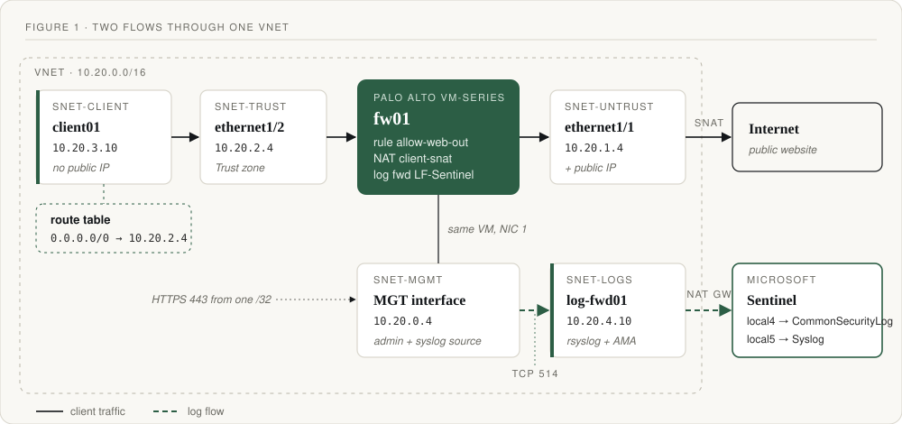

Most "connect your firewall to Sentinel" guides stop at the connector page showing green. I wanted something I could actually trust in an investigation: a real client behind the firewall, real traffic logs in the workspace, and a clear answer to which log format is worth paying for.

So I built it end to end in Azure: a Palo Alto VM-Series firewall with three interfaces, a private log forwarder running the Azure Monitor Agent (AMA), and one client VM whose only way out to the internet is through the firewall. Every firewall event went to Sentinel twice, once in Palo Alto's native format and once as CEF, so I could compare them row for row.

## The design


_Two flows through one VNet: client traffic across the top, logs along the bottom._

One VNet, five subnets, and every subnet has exactly one job and its own NSG:

| Subnet | Range | Role |
|---|---|---|
| snet-mgmt | 10.20.0.0/24 | Firewall admin plane. HTTPS from my /32 only. |
| snet-untrust | 10.20.1.0/24 | Firewall's outside interface (ethernet1/1). |
| snet-trust | 10.20.2.0/24 | Firewall's inside interface (ethernet1/2). |
| snet-client | 10.20.3.0/24 | Users. No public IPs. Default route points at the firewall. |
| snet-logs | 10.20.4.0/24 | Log forwarder. Private, outbound only through a NAT gateway. |

A naming trick that kept me oriented: the third octet is the "room," `.4` is the first usable address (Azure reserves `.0`–`.3`), and `.1` is Azure's gateway in every room.

## The build, in six stages

### 1. A firewall with three doors

To Azure, the VM-Series is just a VM. Inside, it runs PAN-OS, and **NIC order becomes interface names**: NIC 1 is the management port, NIC 2 is `ethernet1/1`, NIC 3 is `ethernet1/2`. Get the order wrong and your zones are wrong.

The portal's VM wizard creates only one NIC, so the pattern is: deploy with management as the first NIC, stop the VM (deallocated), create the untrust and trust NICs with static IPs, attach them **untrust first, then trust**, and turn on IP forwarding for those two only. IP forwarding is what lets a NIC pass traffic that isn't addressed to it, which is the whole point of a firewall. Management doesn't need it.

Inside PAN-OS: UTC time zone, Azure's DNS (`168.63.129.16`), NTP, commit.

### 2. A private log forwarder

The forwarder (`log-fwd01`, Ubuntu) has **no public IP**. It sits in a private subnet with a NAT gateway attached, so it can reach package repos and Azure Monitor, but nothing on the internet can start a connection to it. I administered it with Run Command instead of SSH, so there's no inbound management port at all.

Its NSG has two rules: allow TCP 514 from the firewall's management IP (`/32`) to the forwarder (`/32`), then deny everything else.

### 3. AMA and two data collection rules

In Sentinel I installed the Common Event Format and Syslog solutions and created two data collection rules (DCRs), both scoped to the forwarder only:

- **CEF via AMA** → facility `LOG_LOCAL4` → lands in `CommonSecurityLog`
- **Syslog via AMA** → facility `LOG_LOCAL5` only, every other facility set to none → lands in `Syslog`

**One facility, one rule, one table.** If both rules collected the same facility, every event would land twice. The DCRs live in the workspace's region; the VMs can be somewhere else.

Creating the CEF rule installs AMA on the forwarder, but AMA doesn't listen for the network. Microsoft's `Forwarder_AMA_installer.py` script (run through Run Command) configures rsyslog to listen on 514 over both [TCP and UDP](https://learn.microsoft.com/en-us/azure/sentinel/connect-cef-syslog-ama) and hand messages to AMA. The NSG only lets TCP 514 in from the firewall, so the UDP listener is unreachable from anywhere else.

Before touching the firewall, I sent a `logger` test message on each facility and confirmed both showed up in KQL. Testing the pipe before the source saved me from debugging two things at once.

### 4. Real native logs from the firewall

In PAN-OS: set the service route so syslog leaves from the management interface (`10.20.0.4`), create a syslog server profile pointing to the forwarder (TCP, 514, BSD format, facility `LOCAL5`), and attach it to System and Configuration logs.

To prove it end to end, I created a throwaway address object called `test-marker` (`192.0.2.44/32`, a documentation-only range), committed, and searched for it:

```text
Syslog
| where Facility == "local5" and SyslogMessage has "test-marker"
```
{: file="KQL" }

The row showed the firewall's management IP as the source, collected by the forwarder. Pipeline proven.

### 5. A CEF copy, for comparison

A second syslog profile, same server, facility `LOCAL4`, with a custom CEF format for System, Configuration and Traffic logs (and escaping on, so `=` inside values doesn't break the key/value pairs).

Note that CEF is a lab comparison here, not my production recommendation. Palo Alto [doesn't provide or support CEF configuration guidance after PAN-OS 10.0](https://docs.paloaltonetworks.com/resources/cef) and points newer releases to standard syslog.

### 6. A real client behind the firewall

This is the part that turns "logs arrive" into "logs mean something."

**Azure side:** a client subnet with no NAT gateway and no public IPs, a public IP on the untrust NIC, an NSG on untrust with no custom rules (so nothing inbound from the internet), and an NSG on trust that allows the client (`10.20.3.10/32`) to **Any** on TCP 80/443. Then a route table on the client subnet only, sending `0.0.0.0/0` to the firewall's trust IP (`10.20.2.4`) as a virtual appliance, and a client VM with no public IP and its own NSG.

**PAN-OS side:**

- Zones `Untrust` and `Trust`. `ethernet1/1` and `ethernet1/2` as Layer3 interfaces on the default virtual router, using DHCP with **"automatically create default route" turned off**, so I control routing myself.
- Static routes: `0.0.0.0/0` out `ethernet1/1` to Azure's gateway `10.20.1.1`, and `10.20.3.0/24` out `ethernet1/2` to `10.20.2.1`, so return traffic finds its way back to the client.
- A log forwarding profile `LF-Sentinel` that sends all traffic logs to both syslog profiles.
- A custom service `svc-web` (TCP 80/443, source port empty).
- Security rule `allow-web-out`: Trust → Untrust, source `10.20.3.10`, service `svc-web`, allow, log at session end, forwarded with `LF-Sentinel`.
- Source NAT rule `client-snat`: dynamic IP and port, translated to the `ethernet1/1` interface address. Azure then maps that private IP to the untrust public IP.

How I checked it: the client VM's **effective routes** showed my user route `0.0.0.0/0 → 10.20.2.4` as *Active* and Azure's default internet route as *Invalid*. That's the proof the client can't sneak around the firewall.

## The five values that must match

If logs don't arrive, it's almost always one of these five being different in two places:

| Value | Set on the firewall | Must match |
|---|---|---|
| `10.20.4.10` | Syslog server | Forwarder's static IP |
| TCP | Syslog transport | NSG rule + rsyslog listener |
| 514 | Syslog port | NSG rule + rsyslog listener |
| BSD | Syslog format | What rsyslog expects |
| LOCAL5 / LOCAL4 | Facility | The DCR that collects it |

## One request, end to end

| Time (UTC) | What happened |
|---|---|
| 00:31:38 | `curl` from client01 (`10.20.3.10`) |
| | Route table sends it to the firewall's trust interface |
| | `allow-web-out` allows it; `client-snat` rewrites the source to `10.20.1.4` |
| | Website answers: 200 on HTTPS, 301 on HTTP |
| 00:31:55 | Firewall writes the traffic log at session end |
| 00:31:56 | Row appears in `CommonSecurityLog`, rule name in `cs1` |

About one second from session end to Sentinel. The egress IP the website saw was the untrust public IP, which confirms the SNAT.

```text
CommonSecurityLog
| where DeviceVendor == "Palo Alto Networks"
| where Activity == "Traffic event" and SourceIP == "10.20.3.10"
```
{: file="KQL" }

## Native vs CEF: which one I'd keep

| | Native syslog | CEF |
|---|---|---|
| Shape | Position-based CSV in one text column | Labeled `key=value`, parsed into columns |
| Fields | Every field the firewall has | Only the fields you map |
| Querying | Needs a parser | Works out of the box in `CommonSecurityLog` |
| Vendor support | Supported | Not supported past PAN-OS 10.0 |

With both profiles on, every event is ingested twice, so you pay for it twice. In a real environment I'd pick one format and parse it, not run both.

## Security choices

- One NSG per role. The management NSG is never reused.
- Management HTTPS from one /32. When my IP changes, I update the /32. I never widen it to Any.
- Syslog 514 accepted only from the firewall's /32, with deny-all behind it.
- No public IPs on the client or the forwarder. Run Command instead of SSH.
- Private subnets everywhere, so all outbound traffic is explicit.

Gaps I'd close before calling this production: the default master key, syslog sent in cleartext (TLS syslog is the fix), and CEF's support status. The lab has since been torn down.

## Cost

Running, the firewall was about $2.81/hour (software + compute). Stopped, the leftovers (NAT gateway, public IPs, disks) were about $2/day. "Stopped" means **Stopped (deallocated)** in the portal, not shut down from inside the OS. When finished, delete the lab's resource group and keep the Sentinel workspace.
